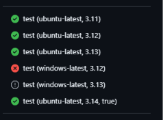
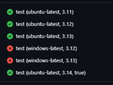
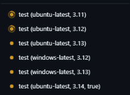

## Q1. Combien de jobs sont générés ? Donnez la liste des combinaisons.

La stratégie `matrix` génère **6 jobs**, correspondant aux 6 combinaisons possibles entre les 2 systèmes d'exploitation et les 3 versions de Python.

| Job | OS | Version Python |
|---|---|---|
| 1 | `ubuntu-latest` | `3.11` |
| 2 | `ubuntu-latest` | `3.12` |
| 3 | `ubuntu-latest` | `3.13` |
| 4 | `windows-latest` | `3.11` |
| 5 | `windows-latest` | `3.12` |
| 6 | `windows-latest` | `3.13` |

**Calcul :** 2 systèmes d'exploitation × 3 versions de Python = 6 jobs.
0

## Q2. Combien de jobs au total ? Rappel : exclude s'applique avant include.

- La matrice génère 6 jobs au total. La combinaison `windows-latest` + Python `3.11` est supprimée par `exclude`, ce qui réduit le nombre de jobs à 5. Ensuite, `include` ajoute la combinaison `ubuntu-latest` + Python `3.14`, ce qui donne finalement 6 jobs.

## Q3. Que se passerait-il si vous tentiez d'exclure la combinaison 3.14 ? Pourquoi ?

- La combinaison Python `3.14` resterait présente. En effet, `exclude` est appliqué avant `include`. Comme Python `3.14` est ajouté par `include` après l'exclusion, il ne sera pas supprimé.

## Q4. Quelle est la différence observée ? Dans quel cas choisiriez-vous true ? false ?

Avec `fail-fast: true`, lorsqu'un job de la matrice échoue, les autres jobs encore en cours ou en attente peuvent être annulés. Dans notre expérience, le job Windows avec Python `3.12` a échoué et le job Windows avec Python `3.13` a été annulé. Les autres jobs ont réussi.

Avec `fail-fast: false`, l'échec d'un job n'interrompt pas les autres jobs de la matrice. Dans notre expérience, les deux jobs Windows avec Python `3.12` et `3.13` ont échoué, mais les autres jobs ont terminé leur exécution.

## Q5. Donnez deux raisons d'utiliser max-parallel en entreprise.

 
**avec Max-parallel = 2**

Les raisons d'utiliser max-parallel en entreprise: 
1. **Maîtriser les coûts :** limiter le nombre de jobs exécutés simultanément permet de réduire la consommation de runners et les coûts de CI/CD.

2. **Limiter la charge sur les ressources :** éviter de lancer trop de jobs en même temps permet de réduire la surcharge des runners et des serveurs utilisés pendant les tests et les builds.
