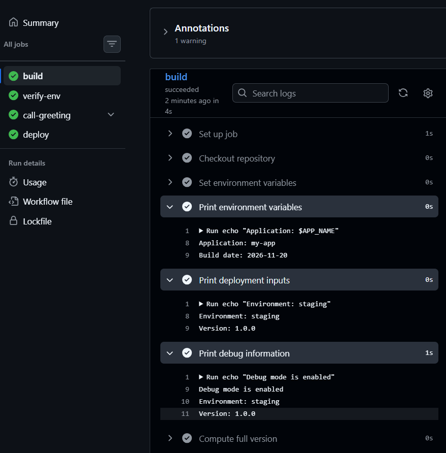
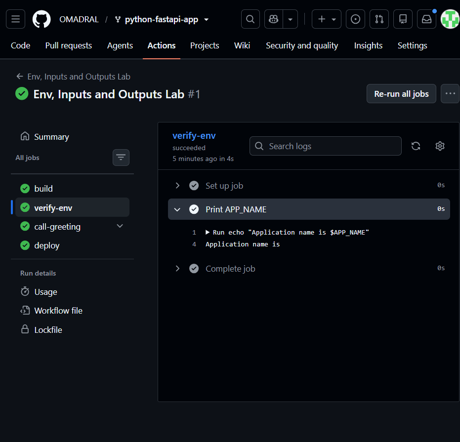
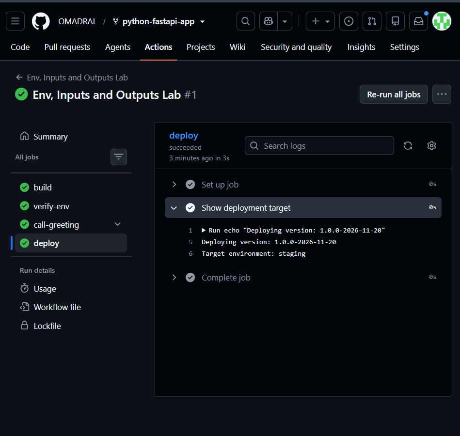
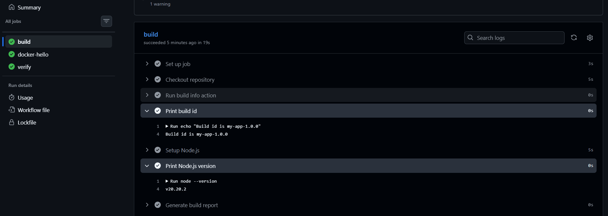
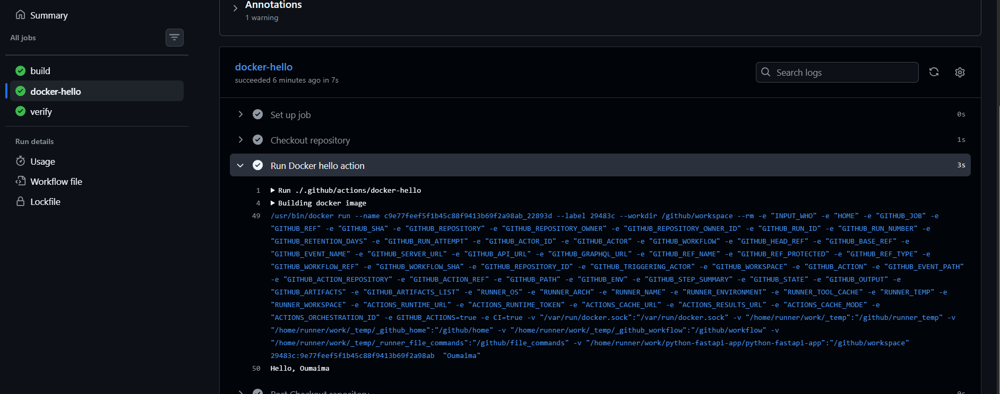
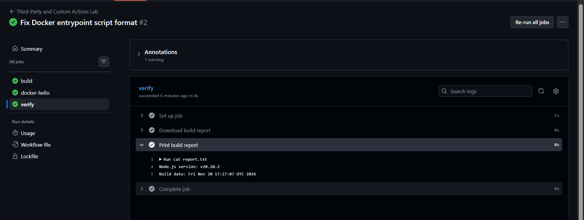

# TP6 – Variables d'environnement, Inputs et Outputs

## Q1. Pourquoi GITHUB_ENV ?

GITHUB_ENV permet de partager les variables d'environnement
entre les différentes steps d'un même job.

### Capture d'écran

---

## Q2. Quelle est la portée de GITHUB_ENV ?

Les variables sont disponibles dans les steps suivantes
du même job, mais pas dans les autres jobs.

### Capture d'écran

---

## Q3. Différence entre > et >>

L'opérateur >> ajoute une nouvelle valeur tandis que >
remplace le contenu précédent du fichier.

## Q4. Différence entre GITHUB_ENV et GITHUB_OUTPUT

GITHUB_ENV partage les variables entre steps.
GITHUB_OUTPUT permet de transmettre des outputs entre jobs
avec needs.

### Capture d'écran

---

## Q5. Que se passe-t-il si on retire needs ?

Le job deploy peut s'exécuter indépendamment du job build.
Il ne peut alors plus récupérer correctement les outputs
de build via needs.build.outputs.

# TP7 – Actions tierces et actions personnalisées

## Q1. Pourquoi actions/checkout n'a-t-il pas besoin de with alors que setup-node en a besoin ?

actions/checkout utilise des paramètres par défaut pour récupérer le dépôt courant. Il n'est donc pas nécessaire de préciser with dans notre cas.

actions/setup-node a besoin de with pour connaître la version de Node.js à installer. Ici, nous utilisons node-version: 20.

## Q2. Pourquoi le job verify ne retrouve-t-il pas report.txt sans l'artefact, alors que les deux jobs partagent le même dépôt ?

Chaque job s'exécute sur un runner indépendant. Le fichier créé dans le job build n'existe donc pas automatiquement dans le job verify.

L'artefact permet de transférer le fichier entre les deux jobs.

## Q6. Pourquoi actions/checkout doit-il s'exécuter avant l'appel d'une action locale ?

actions/checkout récupère les fichiers du dépôt sur le runner.

L'action locale se trouve dans le dépôt, dans .github/actions/build-info/action.yml. Il faut donc récupérer le dépôt avant de pouvoir utiliser cette action.

## Q7. Pourquoi shell: bash est-il obligatoire sur les steps run d'une action composite ?

Dans une action composite, chaque step qui utilise run doit préciser son shell.

GitHub doit connaître l'interpréteur à utiliser pour exécuter les commandes. Ici, nous utilisons bash.

# Captures d'écran TP7

## Exécution du job build

## docker-hello

## Vérification du rapport

